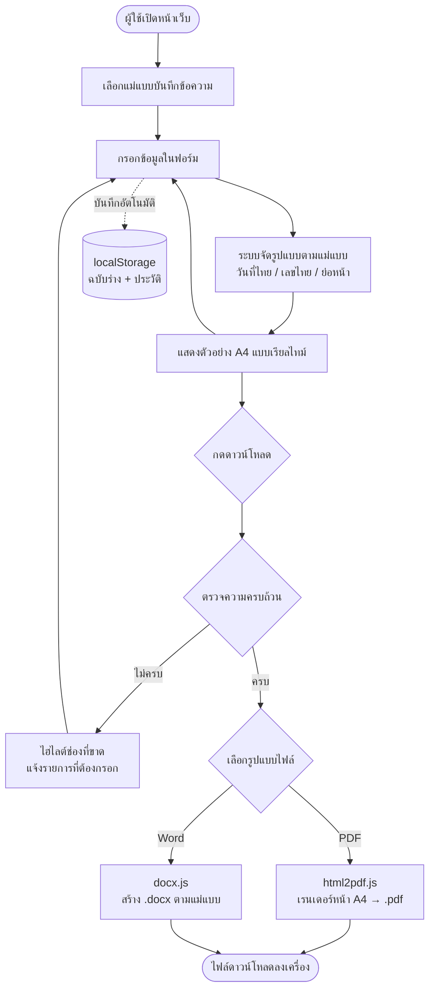
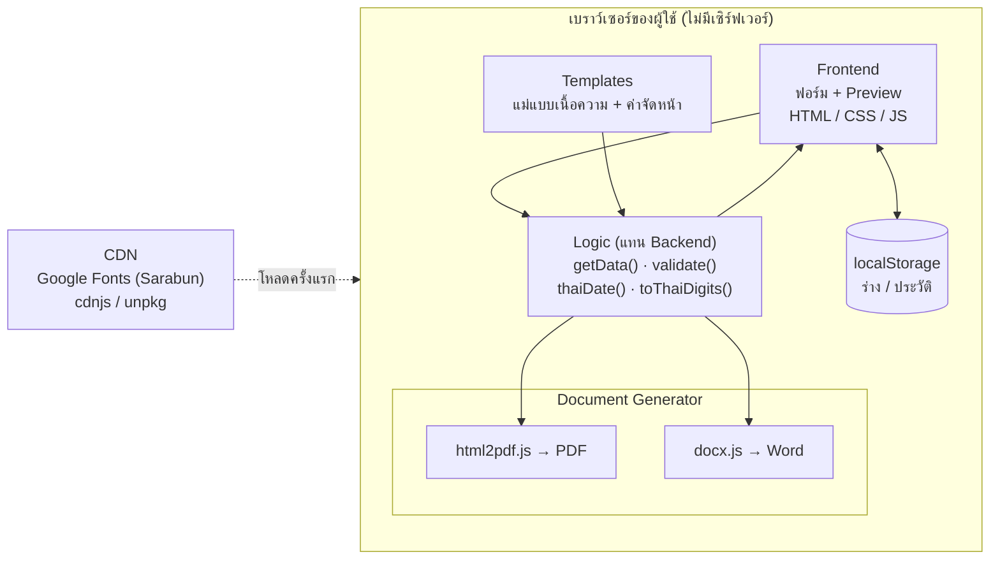
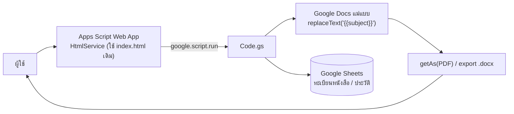

# ระบบสร้างบันทึกข้อความอัตโนมัติ (PDF & Word)

Web Application สำหรับหน่วยงานราชการและสถานศึกษา ใช้สร้าง “บันทึกข้อความ” ตามรูปแบบงานสารบรรณ
ผู้ใช้กรอกข้อมูล ดูตัวอย่างแบบเรียลไทม์ แล้วดาวน์โหลดเป็น **PDF** หรือ **Word (.docx)** ได้ทันที
ไม่ต้องสมัครสมาชิก และไม่ต้องมีเซิร์ฟเวอร์

> เปิดไฟล์ `index.html` ในเบราว์เซอร์ก็ใช้งานได้เลย (ต้องต่ออินเทอร์เน็ต เพื่อโหลดฟอนต์และไลบรารีจาก CDN)

---

## 1. วัตถุประสงค์

| ปัญหาเดิม | ระบบช่วยอย่างไร |
|---|---|
| พิมพ์บันทึกข้อความซ้ำ ๆ เสียเวลา | มีแม่แบบสำเร็จรูป จำข้อมูลที่ใช้บ่อยไว้ในเบราว์เซอร์ และมีประวัติเอกสาร |
| ระยะขอบ ขนาดฟอนต์ และเส้นประผิดระเบียบ | ระบบจัดรูปแบบให้อัตโนมัติจากแม่แบบเดียว ผู้ใช้ไม่ต้องแตะการจัดหน้า |
| ผู้ใช้ทั่วไปไม่ถนัดจัดหน้าใน Word | ผู้ใช้แค่กรอกฟอร์ม แล้วกดดาวน์โหลด |

## 2. คุณสมบัติหลัก

- ฟอร์มมีช่อง ส่วนราชการ, ที่, วันที่, เรื่อง, เรียน, เนื้อความ, ผู้ลงนาม, ตำแหน่ง
- แม่แบบ 5 แบบ ได้แก่ ทั่วไป, ขออนุญาตไปราชการ, ขออนุมัติจัดซื้อ/จัดจ้าง, รายงานผลการดำเนินงาน, ขอความอนุเคราะห์
- ตัวอย่างหน้า A4 อัปเดตทุกครั้งที่พิมพ์
- ตรวจว่ากรอกครบทุกช่องก่อนส่งออก และไฮไลต์ช่องที่ยังว่าง
- ส่งออกเป็น PDF (html2pdf.js) หรือ Word (docx.js) ที่เปิดแก้ต่อใน Word ได้
- แปลงวันที่เป็นแบบไทยและปี พ.ศ. ให้อัตโนมัติ เลือกใช้เลขไทยได้
- ส่วนต่อยอดที่ทำไว้แล้ว ได้แก่ ใส่โลโก้หรือตราครุฑ, แนบรูปลายเซ็น, ประวัติเอกสาร (เก็บใน localStorage)
- ใช้ได้ทั้งบนมือถือและคอมพิวเตอร์

### รูปแบบเอกสารที่ระบบใช้

| องค์ประกอบ | ค่าที่ใช้ |
|---|---|
| กระดาษ | A4 ระยะขอบ บน 1.5 ซม., ซ้าย 3 ซม., ขวา 2 ซม., ล่าง 2 ซม. |
| ตราครุฑหรือโลโก้ | สูง 1.5 ซม. ชิดซ้าย |
| คำว่า “บันทึกข้อความ” | 29 pt ตัวหนา จัดกึ่งกลาง |
| หัวข้อ ส่วนราชการ / ที่ / วันที่ / เรื่อง | 20 pt ตัวหนา ตามด้วยเส้นจุดถึงขอบขวา (ใน Word ใช้ tab leader แบบจุด) |
| เนื้อความ | 16 pt ย่อหน้า 2.5 ซม. จัดชิดขอบแบบไทย (Thai Distributed) |
| ฟอนต์ใน Word | เลือกได้ระหว่าง TH SarabunIT๙, TH SarabunPSK, TH Sarabun New |

> ค่าเหล่านี้อยู่ในฟังก์ชัน `buildDocx()` และใน CSS ส่วน `#doc` ของ `index.html`
> ควรให้งานสารบรรณของหน่วยงานตรวจกับระเบียบฉบับที่ใช้อยู่จริงก่อนนำไปใช้

---

## 3. ขั้นตอนการทำงาน (Workflow)

## 4. โครงสร้างระบบ (System Architecture)

**ทำไมสร้างเอกสารในเบราว์เซอร์ (client-side)?**
- ไม่ต้องมีเซิร์ฟเวอร์ จึงไม่มีค่าใช้จ่าย ใช้ GitHub Pages หรือ Google Sites ก็ได้
- ข้อมูลในเอกสารไม่ถูกส่งออกจากเครื่องผู้ใช้ ซึ่งเหมาะกับหนังสือราชการ
- เบราว์เซอร์จัดสระและวรรณยุกต์ไทยถูกต้องอยู่แล้ว ทำให้ PDF ไม่มีปัญหาสระลอย

---

## 5. เทคโนโลยีที่แนะนำ

| ส่วน | เวอร์ชันปัจจุบัน (MVP) | ทางเลือกเมื่อขยายระบบ |
|---|---|---|
| Frontend | HTML + CSS + Vanilla JS ไฟล์เดียว | Vue / React + Tailwind |
| สร้าง PDF | **html2pdf.js 0.10.1** (html2canvas + jsPDF) | **pdfmake** ฝังฟอนต์ THSarabunNew จะได้ PDF ที่เลือกข้อความได้ หรือใช้ Puppeteer บนเซิร์ฟเวอร์ |
| สร้าง Word | **docx.js 8.5.0** | **docxtemplater** ให้เจ้าหน้าที่ออกแบบแม่แบบเองใน Word แล้วใส่ `{subject}` |
| จัดเก็บ | localStorage (ต่อเบราว์เซอร์) | Google Sheets ผ่าน Apps Script หรือ Firebase / Supabase |
| โฮสต์ | GitHub Pages, Netlify, Google Sites (ฝัง) | Google Apps Script Web App |

### ทางเลือก: Google Apps Script

เหมาะกับโรงเรียนที่ใช้ Google Workspace อยู่แล้ว

สิ่งที่ได้เพิ่มคือ ออกเลขที่หนังสืออัตโนมัติจากชีต, เก็บไฟล์ใน Drive ของหน่วยงาน และล็อกอินด้วยบัญชีโรงเรียน
ข้อแลกเปลี่ยนคือต้องผูกกับบัญชี Google และสร้างไฟล์ได้ช้ากว่าแบบ client-side

---

## 6. ข้อจำกัดที่ควรรู้

- **PDF เป็นภาพ** html2pdf.js แปลงหน้ากระดาษเป็นภาพ จึงคมชัดแต่คัดลอกข้อความไม่ได้ ถ้าต้องการให้เลือกข้อความได้ ให้เปลี่ยนไปใช้ pdfmake พร้อมฝังฟอนต์ หรือสั่งพิมพ์ด้วย Ctrl+P แล้วเลือก “บันทึกเป็น PDF”
- **ฟอนต์ใน Word** ไฟล์ .docx อ้างชื่อฟอนต์ TH Sarabun เครื่องที่เปิดไฟล์ต้องติดตั้งฟอนต์นี้ ซึ่งเครื่องราชการส่วนใหญ่มีอยู่แล้ว
- **ตัวอย่างบนเว็บใช้ Google Sarabun** ระบบย่อขนาดให้ใกล้กับ TH Sarabun 16 pt ใน Word แต่ตำแหน่งตัดบรรทัดอาจต่างกันเล็กน้อย
- **ประวัติเอกสาร** เก็บในเบราว์เซอร์เครื่องนั้นเท่านั้น ถ้าล้างข้อมูลเบราว์เซอร์ ประวัติจะหายไป
- **ลายเซ็นอิเล็กทรอนิกส์** ในเวอร์ชันนี้เป็นการวางรูปลายเซ็นลงในเอกสารเท่านั้น ยังไม่ใช่ลายมือชื่อดิจิทัลที่ตรวจสอบได้ (ดูข้อ 7)

## 7. แผนต่อยอด (Roadmap)

1. **ระยะที่ 1 (เสร็จแล้ว):** ฟอร์ม, แม่แบบ, Preview, PDF/Word, โลโก้, รูปลายเซ็น, ประวัติในเครื่อง
2. **ระยะที่ 2:** ส่วน “อ้างถึง / สิ่งที่ส่งมาด้วย”, ข้อความ “ความเห็นผู้บังคับบัญชา” ท้ายบันทึก, ให้แอดมินเพิ่มแม่แบบเองได้ (เก็บเป็น JSON)
3. **ระยะที่ 3:** ทะเบียนหนังสือรับและส่ง พร้อมออกเลข “ที่” อัตโนมัติ (Apps Script + Sheets หรือ Supabase), ล็อกอินด้วยบัญชีหน่วยงาน
4. **ระยะที่ 4:** ลงลายมือชื่อดิจิทัลด้วยใบรับรองตามมาตรฐาน PAdES ให้ตรวจสอบได้ตามกฎหมายธุรกรรมทางอิเล็กทรอนิกส์ และเชื่อมกับระบบสารบรรณอิเล็กทรอนิกส์ (e-Saraban)

## 8. โครงสร้างโค้ด (`index.html`)

| ส่วนในไฟล์ | หน้าที่ |
|---|---|
| `TEMPLATES` | แม่แบบเรื่องและเนื้อความ เพิ่มแม่แบบได้ที่นี่ |
| `getData()` | อ่านฟอร์ม แปลงวันที่และเลขไทย แยกย่อหน้า เป็นข้อมูลชุดเดียวที่ทั้ง 3 ช่องทางใช้ร่วมกัน |
| `validate()` | ตรวจว่ากรอกครบทุกช่อง |
| `render()` | วาดตัวอย่าง A4 |
| `exportPdf()` | สร้างไฟล์ PDF |
| `buildDocx()` / `exportDocx()` | สร้างไฟล์ Word กำหนดระยะขอบ ขนาดฟอนต์ และ tab leader เส้นจุด |
| `store` | อ่านและเขียน localStorage (ห่อด้วย try/catch ให้แอปทำงานได้แม้เบราว์เซอร์บล็อก) |
